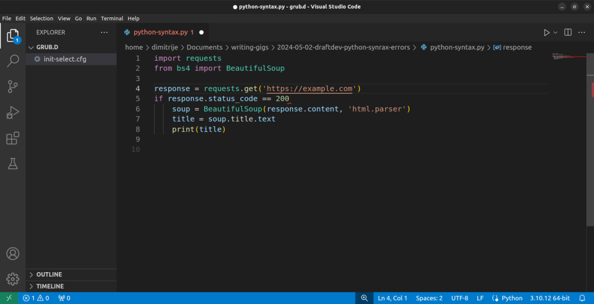

# 避免和修复 Python 语法错误

[](https://www.bright.cn/) 

本指南介绍常见的 Python 语法错误、可用于预防这些错误的主动策略，以及高效解决这些错误的应对方法：

- [语法错误的类型](#语法错误的类型)
- [避免语法错误](#避免语法错误)
  - [主动策略](#主动策略)
  - [应对策略](#应对策略)

## Python 中的语法错误

[Python 解释器](https://docs.python.org/3/tutorial/interpreter.html)执行 Python 代码，并将其转换为机器语言。如果违反语法规则，执行就会停止，并显示包含回溯信息的错误消息。

语法错误源于结构问题，类似于语言中的语法问题。例如，Python 要求对 `if` 语句和循环等代码块使用正确的缩进。

与程序运行期间发生的[运行时错误](https://docs.python.org/3/library/exceptions.html#RuntimeError)不同，语法错误会导致程序完全无法执行。

## 语法错误的类型

Python 遵循许多[语法规则](https://peps.python.org/pep-0008/)，因此语法错误很常见。本节将介绍几种常见错误及其解决方法。

### 标点符号位置错误、缺失或不匹配

Python 依靠标点符号来组织代码结构。请确保标点符号位置正确且相互匹配，以避免语法错误。

例如，圆括号 `()`、方括号 `[]` 和花括号 `{}` 必须始终成对使用。如果使用了左括号，就必须使用对应的右括号。

在下面的示例中，有一个花括号没有闭合：

```python
# Incorrect
proxies = {
    'http': proxy_url,
    'https': proxy_url

```

如果尝试运行此代码，解释器会抛出 `SyntaxError`：

```python
File "python-syntax-errors.py", line 2
    proxies = {
            ^
SyntaxError: '{' was never closed
```

Python 解释器会提供详细的错误消息，包括文件名、行号以及指示错误发生位置的箭头。在这里，它指出 `'{' was never closed`。

借助这些信息，你可以轻松确定问题，并通过闭合花括号来修复它。

```python
# Correct
proxies = {
    'http': proxy_url,
    'https': proxy_url
} # Closed a curly bracket
```

引号（`'` 或 `"`）经常在 Python 中引发问题。与许多编程语言一样，Python 使用引号定义字符串。请始终确保字符串两端使用相同类型的引号。

```python
# Incorrect
host = "brd.superproxy.io'
```

混用单引号和双引号会导致语法错误：

```python
File "python-syntax-errors.py", line 2
    host = "brd.superproxy.io'
        ^
SyntaxError: unterminated string literal (detected at line 2)
```

在这里，解释器会告诉你第二行的字符串字面量尚未结束：

```python
# Correct
host = "brd.superproxy.io"
```

当字符串同时包含单引号和双引号时，可以使用三引号（`'''` 或 `"""`）将字符串括起来，如下所示：

```python
quote = """He said, "It's the best proxy service you can find!", and showed me this provider."""
```

逗号用于分隔列表、元组和函数参数中的项目。缺少逗号可能会导致意外错误。

```python
# Incorrect
proxies= [
    {"http": "http://123.456.789.1:8080", "https": "https://123.456.789.1:8080"}
    {"http": "http://98.765.432.1:3128", "https": "https://98.765.432.1:3128"}
    {"http": "http://192.168.1.1:8080", "https": "https://192.168.1.1:8080"}
]
```

运行此代码会出现以下错误消息：

```python
File "python-syntax-errors.py", line 3
{"http": "http://123.456.789.1:8080", "https": "https://123.456.789.1:8080"}
^^^^^^^^^^^^^^^^^^^^^^^^^^^^^^^^^^^^^^^^^^^^^^^^^^^^^^^^^^^^^^^^^^^^^^^^^^^^
SyntaxError: invalid syntax. Perhaps you forgot a comma?
```

错误消息很有帮助，但可能无法发现所有问题。如果检测到缺少逗号，请检查周围的代码是否还缺少其他逗号，以确保语法正确。

```python
# Correct
proxies = [
    {"http": "http://123.456.789.1:8080", "https": "https://123.456.789.1:8080"},
    {"http": "http://98.765.432.1:3128", "https": "https://98.765.432.1:3128"},
    {"http": "http://192.168.1.1:8080", "https": "https://192.168.1.1:8080"}
]
```

与逗号不同，冒号用于开始新的代码块（例如 `if` 语句或 `for` 循环中的代码块）：

```python
import requests
from bs4 import BeautifulSoup

# Incorrect
response = requests.get('https://example.com')
if response.status_code == 200
    soup = BeautifulSoup(response.content, 'html.parser')
    title = soup.title.text
    print(title)
)
```

忘记添加冒号会导致以下语法错误：

```python
if response.status_code == 200
    ^
SyntaxError: expected ':'   
```

从这条错误消息中，很容易判断出缺少冒号，你可以在建议的位置添加冒号来修复问题：

```python
import requests
from bs4 import BeautifulSoup

# Correct
response = requests.get('https://example.com')
if response.status_code == 200:
    soup = BeautifulSoup(response.content, 'html.parser')
    title = soup.title.text
    print(title)

```

### Python 关键字拼写错误、位置错误或缺失

[Python 关键字](https://docs.python.org/3/reference/lexical_analysis.html#keywords)是具有特定含义的保留字，不能用作变量名。关键字拼写错误、位置错误或缺失都会导致错误。

例如，在导入 `requests` 和 `pprint` 模块时拼错 `import` 关键字可能会引发问题。

```python
# Incorrect
improt requests
import pprint
```

此拼写错误会导致解释器抛出以下 `invalid syntax` 错误：

```python
File "python-syntax-errors.py", line 2
    improt requests
        ^^^^^^^^
SyntaxError: invalid syntax
```

有些错误消息可能比较模糊，需要格外留意。在本例中，箭头指向 `requests`，表示检测到语法错误的位置。由于模块名称拼写错误不会导致语法错误，因此问题很可能是 `import` 关键字拼写错误。

更正 `import` 即可解决该错误。

```python
# Correct
import requests
import pprint
```

你也可能像这样错误地编写 `from ... import …` 语句：

```python
import BeautifulSoup from bs4
```

虽然看起来没有问题，但运行上述代码会报错，因为 `from` 关键字应位于 `import` 之前：

```python
File "python-syntax-errors.py", line 2
import BeautifulSoup from bs4
    ^^^^
SyntaxError: invalid syntax
```

交换 `from` 和 `import` 的位置即可解决问题：

```python
from bs4 import BeautifulSoup
```

在 Python 中，忘记关键字可能导致各种错误。这个问题比较隐蔽，因为缺少的关键字不同，出现的错误也可能不同。

例如，在本应返回值的函数中省略 `return` 关键字可能会导致意外行为。

```python
def fetch_data():
    response = requests.get('https://example.com')
    soup = BeautifulSoup(response.content, 'html.parser')
    data = soup.find_all('div', class_='data')
    # Missing a return statement here
    
data = fetch_data()
```

这不会抛出语法错误，但函数会返回 `None`，而不是预期结果。添加 `return` 关键字即可修复上述代码：

```python
def fetch_data():
    response = requests.get('https://example.com')
    soup = BeautifulSoup(response.content, 'html.parser')
    data = soup.find_all('div', class_='data')
    return data

data = fetch_data()
```

如果在定义函数时忘记 `def` 关键字，就会遇到语法错误：

```python
# Missing the `def` keyword
fetch_data():
    response = requests.get('https://example.com')
    soup = BeautifulSoup(response.content, 'html.parser')
    data = soup.find_all('div', class_='data')
    return data

data = fetch_data()
```

上述代码会引发语法错误，因为解释器预期函数名称前有一个关键字：

```python
File "python-syntax-errors.py", line 1
   fetch_data():
               ^
SyntaxError: invalid syntax
```

添加 `def` 关键字即可解决该错误：

```python
def fetch_data():
    response = requests.get('https://example.com')
    soup = BeautifulSoup(response.content, 'html.parser')
    data = soup.find_all('div', class_='data')
    return data

data = fetch_data()
```

在条件语句中忘记 `if` 关键字会导致错误，因为解释器预期条件前有一个关键字。

```python
import requests
from bs4 import BeautifulSoup

response = requests.get('https://example.com')
# Missing the if keyword
response.status_code == 200:
    soup = BeautifulSoup(response.content, 'html.parser')
    title = soup.title.text
    print(title)
```

```python
File "python-syntax-errors.py", line 6
   response.status_code == 200:
                              ^
SyntaxError: invalid syntax
```

只需添加 `if` 关键字即可修复此问题：

```python
import requests
from bs4 import BeautifulSoup

response = requests.get('https://example.com')
if response.status_code == 200:
    soup = BeautifulSoup(response.content, 'html.parser')
    title = soup.title.text
    print(title)
```

> **注意**：缺少关键字也可能引发其他类型的错误，因此请格外小心。

### 错误使用赋值运算符

在 Python 中，`=` 用于[赋值](https://docs.python.org/3/reference/expressions.html)，而 `==` 用于[比较](https://docs.python.org/3/library/stdtypes.html#comparisons)。混淆二者可能会导致语法错误。

```python
import requests
from bs4 import BeautifulSoup

# Incorrect
response = requests.get('https://example.com', proxies=proxies)
if response = requests.get('https://example.com/data', proxies=proxies):
    soup = BeautifulSoup(response.content, 'html.parser')
    data = soup.find_all('div', class_='data')
    for item in data:
    print(item.text)
else:
    print("Failed to retrieve data")
```

在上述代码中，解释器正确检测出了问题的原因：

```python
File "python-syntax-errors.py", line 5
if response = requests.get('https://example.com/data', proxies=proxies)
     ^^^^^^
```

在这里，你要检查响应是否与 `request.get()` 的结果匹配。要修复错误，请在 `if` 语句中将赋值运算符（`=`）替换为比较运算符（`==`）。

```python
import requests
from bs4 import BeautifulSoup

# Correct
response = requests.get('https://example.com', proxies=proxies)
# Change in the following line
if response == requests.get('https://example.com/data', proxies=proxies):
    soup = BeautifulSoup(response.content, 'html.parser')
    data = soup.find_all('div', class_='data')
    for item in data:
    print(item.text)
else:
    print("Failed to retrieve data")
```

### 缩进错误

Python 依靠缩进来定义代码块。缩进错误会导致解释器无法识别代码块结构，进而引发 `IndentationError`。

```python
# Incorrect
async with async_playwright() as playwright:
await run(playwright)
```

在上述示例中，代码块定义（冒号后面的部分）缺少缩进。运行代码会导致错误。

```python
File "python-syntax-errors.py", line 2
    await run(playwright)
    ^
IndentationError: expected an indented block after the with statement on line 1
```

要修复此问题，请遵循 Python 的语法规则，为代码块添加正确的缩进：

```python
# Correct
async with async_playwright() as playwright:
    await run(playwright)
```

### 变量声明问题

变量名必须以字母或下划线开头，并且只能包含字母、数字和下划线。Python 区分大小写，因此 `myvariable`、`myVariable` 和 `MYVARIABLE` 是不同的变量。

变量名不能以数字开头。下面的示例以 `1` 开头，违反了这条规则。

```python
# Incorrect
1st_port = 22225
```

运行上述代码时，解释器会抛出 `SyntaxError`：

```python
File "python-syntax-errors.py", line 2
    1st_port = 1
    ^
SyntaxError: invalid decimal literal
```

要修复此问题，变量名必须以字母或下划线开头。以下任一选项都可以：

```python
# Correct
first_port = 22225
port_no_1 = 22225
```

### 函数定义和调用错误

要定义函数，请使用 `def` 关键字，后跟函数名称、圆括号和冒号。调用函数时，请使用函数名称并在其后添加圆括号。缺少其中任何元素都会导致语法错误。

```python
import requests
from bs4 import BeautifulSoup

# Incorrect
def fetch_data
response = requests.get('https://example.com')
soup = BeautifulSoup(response.content, 'html.parser')
data = soup.find_all('div', class_='data')
return data

# Incorrect
data = fetch_data
```

在此示例中，元素缺失导致了多个语法错误。要修复这些错误，请在函数定义中的 `fetch_data` 后添加圆括号和冒号，并在最后一行的函数调用后添加圆括号。

```python
import requests
from bs4 import BeautifulSoup

# Corrected
def fetch_data():
    response = requests.get('https://example.com')
    soup = BeautifulSoup(response.content, 'html.parser')
    data = soup.find_all('div', class_='data')
    return data

# Corrected
data = fetch_data()

```

函数定义中缺少圆括号或冒号始终会导致语法错误。但是，调用函数时忘记圆括号（`fetch_data()`）可能不会触发异常，却会导致意外行为。

## 避免语法错误

编写无错误代码是一项需要通过实践掌握的技能。了解并采用以下最佳实践，可以帮助你避免常见的语法错误。

### 主动策略

处理语法错误的最佳方式是防患于未然。开始项目之前，请先熟悉该语言最常见的语法规则。  

#### 使用支持语法高亮和缩进检查的代码编辑器

优秀的代码编辑器可以通过语法高亮和缩进检查等功能帮助避免语法错误。这些工具可以在代码运行前发现问题。

例如，编辑器中的红色标记可能表示 `if response.status_code == 200` 中缺少冒号。



#### 遵循一致的编码风格指南

一致性是编写整洁、无错误代码的关键。遵循一致的风格可以提高可读性，并让错误更容易被发现。

在 Python 中，[PEP 8 风格指南](https://peps.python.org/pep-0008/)是标准规范，其中提供了有关变量命名、缩进和空白字符使用的指导。

#### 使用小型且定义明确的函数编写代码

将代码拆分为小型且定义明确的函数，可以提高代码的可管理性并简化调试。每个函数都应只有一个清晰的用途。承担过多任务的函数会更难理解和调试。

例如，考虑 `scrape_and_analyze()` 函数：

```python
import requests
from bs4 import BeautifulSoup
from textblob import TextBlob

def scrape_and_analyze():
    url = "https://example.com/articles"
    response = requests.get(url)
    soup = BeautifulSoup(response.content, "html.parser")
    titles = soup.find_all("h2", class_="article-title")
    sentiments = []
    for title in titles:
    title_text = title.get_text()
    blob = TextBlob(title_text)
    sentiment = blob.sentiment.polarity
    sentiments.append(sentiment)
    return sentiments

print(scrape_and_analyze())

```

在此示例中，将该函数拆分为多个更小的函数会更易于阅读，每个函数只执行一小部分更易管理的代码：

```python
import requests
from bs4 import BeautifulSoup
from textblob import TextBlob

def scrape_titles(url):
    """Scrape article titles from a given URL."""
    response = requests.get(url)
    soup = BeautifulSoup(response.content, "html.parser")
    titles = soup.find_all("h2", class_="article-title")
    return [title.get_text() for title in titles]

def analyze_sentiment(text):
    """Analyze sentiment of a given text."""
    blob = TextBlob(text)
    return blob.sentiment.polarity

def analyze_titles_sentiment(titles):
    """Analyze sentiment of a list of titles."""
    return [analyze_sentiment(title) for title in titles]

def scrape_and_analyze(url):
    """Scrape titles from a website and analyze their sentiment."""
    titles = scrape_titles(url)
    sentiments = analyze_titles_sentiment(titles)
    return sentiments

url = "https://example.com/articles"
print(scrape_and_analyze(url))
```

### 应对策略

即使已经尽力预防，错误仍可能发生。Python 会提供说明问题及其所在位置的错误消息。

#### 仔细阅读错误消息

Python 错误消息会提供有关问题及其所在位置的详细信息。仔细分析这些信息有助于找出问题并找到解决方案。

#### 有策略地使用打印语句

在小型项目中，使用 `print()` 语句可以快速跟踪执行流程并检查变量值。它适合快速调试，但由于存在安全和性能风险，不应在生产环境中使用。

对于复杂问题或大型代码库，调试器更为有效。调试器允许设置断点、逐步执行代码，并跨多个函数调用检查变量，从而提供更可控的调试过程。

#### 利用在线资源和社区

如果你被棘手的错误难住，请毫不犹豫地寻求帮助。[Python 文档](https://docs.python.org/3/)和 [Real Python](https://realpython.com/)等在线资源提供了实用指导。[r/Python](https://www.reddit.com/r/Python/)、[r/LearnPython](https://www.reddit.com/r/learnpython/)、[Stack Overflow](https://stackoverflow.com/questions/tagged/python)和 [Python 论坛](https://python-forum.io/)等社区也是寻找答案和解决方案的好去处。

## 总结

无论你需要[可靠的代理服务](https://www.bright.cn/proxy-types)、自动化数据采集、[开箱即用的数据集](https://www.bright.cn/products/datasets)，还是[自动执行网页爬虫任务](https://www.bright.cn/products/web-scraper)，Bright Data 都能提供相应解决方案，让你的网页爬虫项目更高效、更多产。想学习如何使用 Python 进行网页爬虫吗？请阅读我们详细的[分步式 Python 抓取指南](https://www.bright.cn/blog/how-tos/web-scraping-with-python)。

立即注册，找到适合你需求的产品，并于今天开始免费试用！
